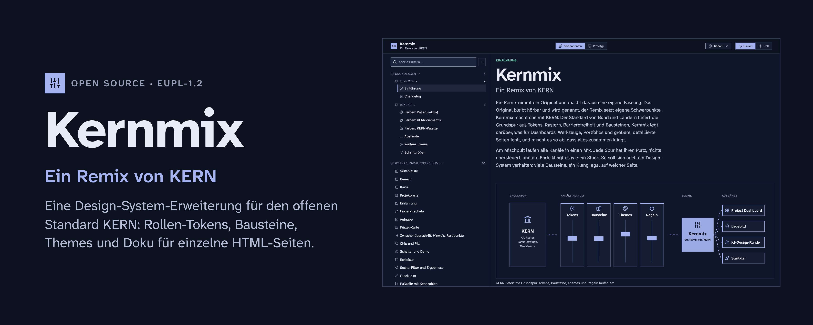
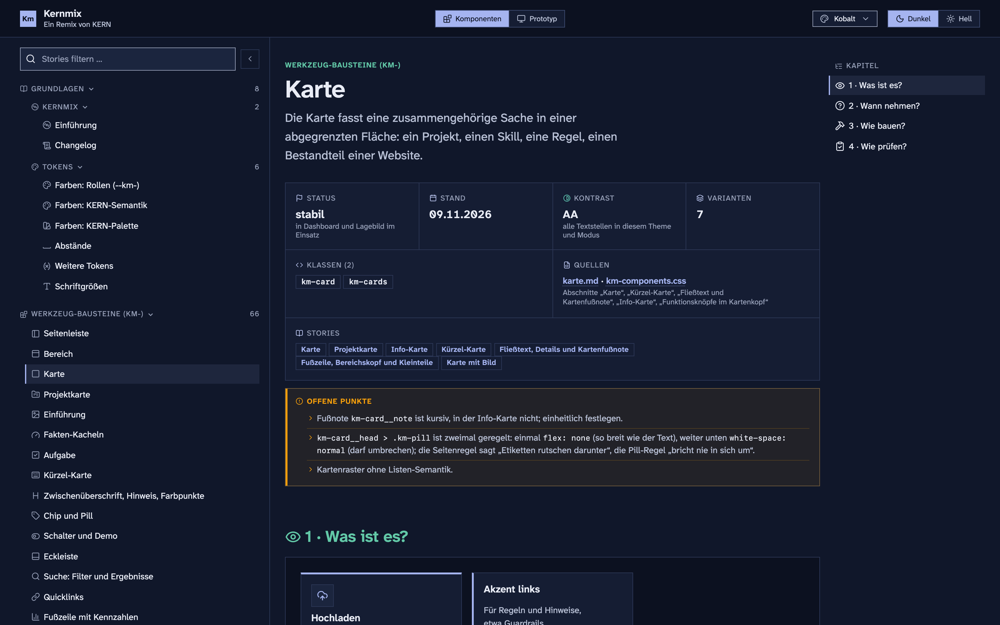
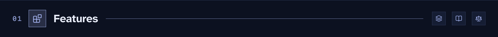
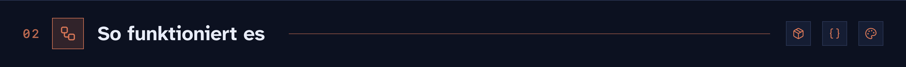
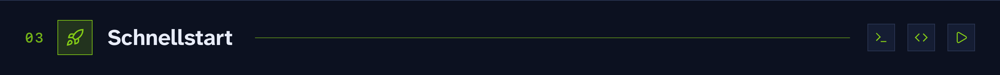
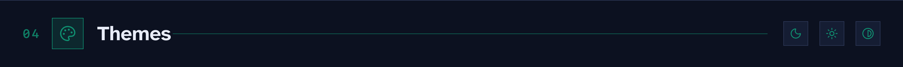
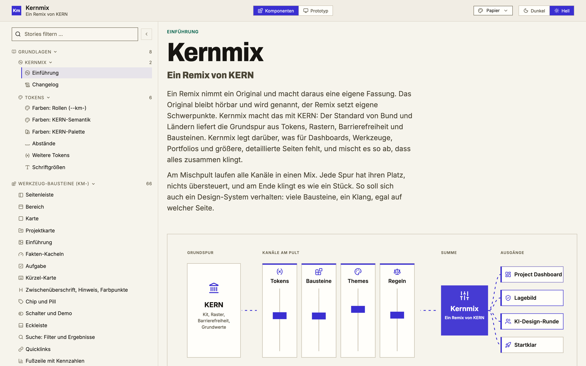
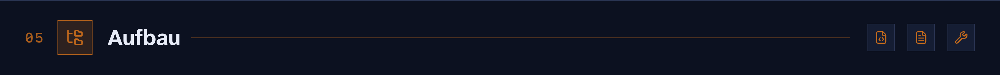
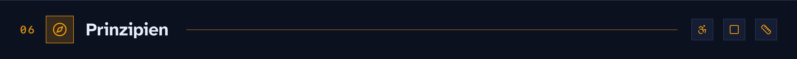
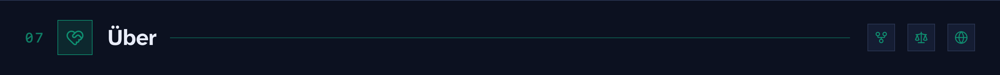

# Kernmix

**Ein Remix von KERN.** Eine Design-System-Erweiterung für den offenen Standard [KERN](https://www.kern-ux.de/): Rollen-Tokens, Bausteine, Themes und Doku für einzelne HTML-Seiten.

[English](README.md) · [Komponentenbeschreibung online](https://kernmix.thinkrepeat.com/) · [Changelog](CHANGELOG.md)

KERN ist der offene UX-Standard von Bund und Ländern. Er liefert die Grundspur: Tokens, Raster, Barrierefreiheit und Bausteine. Kernmix lässt das KERN-Kit unverändert und ergänzt, was Werkzeuge, Dashboards und längere Doku-Seiten brauchen: Rollen-Tokens, über 30 Bausteine mit dem Präfix `km-`, zwei Themes und eine Doku je Baustein. Alles läuft per `file://`, ohne Server, CDN oder Paketmanager.

Kernmix trägt das [Project Dashboard](https://github.com/donludwig/project-dashboard), das es in eine einzelne HTML-Datei einbettet.





### Tokens und Themes

- 🎚️ **Rollen-Tokens** `--km-*` in `src/km-roles.css`: Sie zeigen auf semantische KERN-Tokens, wo KERN eines hat, und erweitern das Namensschema von KERN, wo es keines gibt (Farben, Abstände, Schrift).
- 🧱 **Core Token** in `src/km-core.css`: eigene Farbreihen und fünf Datenfarben `--km-color-data-*`, in OKLCH.
- 🔩 **Komponenten-Tokens** `--km-component-*` für Werte, die zu einem Baustein gehören.
- 🎨 **Zwei Themes**, je hell und dunkel: Kobalt (`kern-nah.css`) und Papier (`startklar.css`). Ohne Theme sehen die Bausteine aus wie KERN.
- 🔤 **Schriften lokal** unter SIL OFL 1.1: Atkinson Hyperlegible Next, Inter und Archivo, aus Dateien geladen, nie von einem Schriftdienst.
- ✏️ **Icons**: Lucide 1.49.0 in `assets/lucide.json` im 24er-Raster; Strichstärke, Linienenden und Ecken setzt das Theme.

### Bausteine

- 🧩 **Über 30 Bausteine** in `src/km-components.css`: Seitenleiste mit Icon-Leiste, Bereich, Karte, Tabelle, Filter-Leiste, Segmented Control, Kapitelleiste, Dialog, Suche, Spaltenauswahl, Aufgaben und weitere. Bausteine lesen nur `--km-*`.
- 📊 **Standard-Tabelle** `km-table.js`: eine Rolle je Spalte, ein Icon in jeder Kopfzelle, Datum mit relativer Angabe und Aktivitätsbalken, Sortierung, laufende Nummer und die Aktionsspalte zuletzt.
- 🪟 **Panels** `km-popup.js`: Jedes Dropdown, Menü und Panel schließt mit Esc und mit Klick daneben, danach liegt der Fokus wieder auf dem Knopf.
- 📝 **Bausteine für Fragebögen**: Antwort-Knöpfe `km-answer`, Prüfkarte `km-criterion`, Feld, Score, Fortschritt und Begriff.
- 🧭 **Seitengerüst** `km-shell` mit einer Seitenleiste, die zur Icon-Leiste einklappt, und einer Kapitelleiste, die die aktuelle Stelle markiert.

### Doku

- 📖 **Komponentenbeschreibung** (`storybook/index.html`): Einführung, Grundlagen (Farben, Abstände, Schrift, Tokens), jeder Baustein mit seiner Doku, Proposals und die offiziellen KERN-Stories. Theme, Modus und Breite (360, 768, 1280, voll) lassen sich oben umschalten, die Adresse merkt sich den Zustand.
- 🖥️ **Reiter Prototyp**: das Project Dashboard als Demo mit erfundenen Daten (`prototyp/index.html`), gebaut auf Kernmix und mit demselben Theme und Modus umschaltbar.
- 🔗 **Querverweise**: Jeder Eintrag zeigt, welche Bausteine er enthält und wo er verwendet wird; die Kontraste der Farben werden live für Theme und Modus gerechnet.
- 📚 **Komponenten-Doku** in `docs/komponenten/`: vier Kapitel je Baustein (Was ist es? Wann nehmen? Wie bauen? Wie prüfen?) mit Regeln für Agenten und Menschen.
- 📏 **Seitenregeln** in `docs/seitenregeln.md`: Navigation, Filter, Tabellen, Karten, Kontrast, schmale Breite und was vor dem Abschluss einer Seite gemessen wird.
- 🗳️ **Entscheidungen** werden als ADR und DDR festgehalten und später veröffentlicht.

### Werkzeuge und Prüfungen

- 🧰 **Einbetten** mit `tools/einbetten.py`: Kit, Kernmix, Theme und Skripte kommen in eine einzelne HTML-Datei; `--check` meldet, ob der Block veraltet ist.
- 🔍 **KERN-Prüfung**: `tools/build.py` bricht ab, wenn ein `--kern-`-Token aus `src/` im eingebundenen Kit fehlt.
- 🧪 **Seitenprüfung**: `tools/pruefe-seiten.py` öffnet die gebauten Seiten in Headless Chrome und prüft Tabellen, Panels, Schriftzeichen als Icon und Skriptfehler.
- ♿ **Kontrast**: für jede Textrolle auf jeder Fläche in beiden Themes und Modi gerechnet, Text mindestens 4,5:1, Bedienelemente mindestens 3:1.




Kernmix baut auf dem KERN-Kit auf, so wie es veröffentlicht ist. `vendor/kern/` enthält `kern.min.css`, die Fira-Sans-Dateien und eine Datei `VERSION` des KERN-Kits 2.8.2, und Kernmix ändert daran nichts. Alles andere liegt in Schichten darüber:

- Das Kit bringt Grundstile und die semantischen `--kern-*`-Tokens. Kernmix setzt Tokens und überschreibt keine `kern-*`-Klassen.
- `src/km-roles.css` ordnet jeder Rolle ein semantisches KERN-Token zu, wo es eines gibt. Nur wo KERN keines hat, ergänzt Kernmix ein eigenes im Namensschema von KERN.
- `src/km-components.css` liest nur `--km-*`, nie direkt eine Farbe oder Größe.
- Eine Theme-Datei setzt Werte für hell und dunkel und ergänzt keine Selektoren für Bausteine.
- `tools/einbetten.py` schreibt Kit, Kernmix und ein Theme in die Seite, so läuft eine HTML-Datei allein.

### Wenn KERN ein Release veröffentlicht

1. Das Kit in `vendor/kern/` durch die veröffentlichten Dateien ersetzen.
2. `python3 tools/build.py` aufrufen. Das Skript sammelt jedes `--kern-`-Token, das `src/` liest oder ein Theme setzt, und vergleicht die Liste mit den Tokens in der neuen `kern.min.css`. Fehlt eines, bricht der Build ab und nennt Datei und Token; umbenannte oder entfernte Tokens fallen so sofort auf. Bekannte Lücken stehen mit Begründung in `KERN_AUSNAHMEN`.
3. Die betroffenen Rollen in `src/km-roles.css` auf die neuen Tokens umstellen und neu bauen. Bausteine und Themes ziehen mit, weil sie Rollen lesen, und Kernmix setzt auf dem aktuellen KERN-Release auf. Die gebauten Dateien nennen die Kit-Version im Kopf.

`tools/build-storybook.py` prüft außerdem jede Klasse der offiziellen KERN-Stories gegen das eingebundene Kit und markiert fehlende an der Story.



### Ansehen

```bash
git clone https://github.com/donludwig/kernmix.git
cd kernmix
open storybook/index.html
```

### In eine Seite einbinden

```html
<html data-kern-theme="dark">
<link rel="stylesheet" href="vendor/kern/kern.min.css">
<link rel="stylesheet" href="dist/fonts.css">
<link rel="stylesheet" href="dist/km.css">
<link rel="stylesheet" href="dist/themes/kern-nah.css">
```

Die Reihenfolge zählt: KERN-Kit, Kernmix, Theme. `data-kern-theme="light"` schaltet auf hell.

### In eine einzelne HTML-Datei einbetten

```bash
python3 tools/einbetten.py pfad/zur/seite.html --schriften
```

Das Skript schreibt Kit, Kernmix, Theme und beide Skripte zwischen `<!-- KERN-SYSTEM:BEGIN -->` und `<!-- KERN-SYSTEM:END -->` in den `<head>`. Nach jeder Änderung erneut aufrufen; ersetzt wird nur dieser Block. `--zusatz-theme startklar` bettet das zweite Theme ausgeschaltet mit ein, für Seiten mit Theme-Auswahl.

### Bauen

```bash
python3 tools/build.py              # dist/ aus src/, prüft jedes --kern-Token gegen das Kit
python3 tools/build-storybook.py    # storybook/index.html, die Komponentenbeschreibung
python3 tools/build-doku.py         # docs/index.html
python3 tools/pruefe-seiten.py      # prüft die gebauten Seiten in Headless Chrome
```

Nur Python 3 mit Standardbibliothek. Die offiziellen KERN-Stories kommen in die Komponentenbeschreibung, wenn `KERN_STORIES` auf einen Ordner mit `*.stories.js` aus dem KERN-Repository zeigt; sonst fehlt diese Gruppe.



| Theme | Datei | Schrift | Charakter |
|---|---|---|---|
| Kobalt | `dist/themes/kern-nah.css` | Atkinson Hyperlegible Next | kühler blauer Akzent, Signalfarbe Bernstein, eckige Ecken und Linienenden |
| Papier | `dist/themes/startklar.css` | Inter, Überschriften in Archivo Extrabold mit 88 % Breite | warme Papierflächen, Tinte, Indigo-Akzent, runde Linienenden |
| KERN | keine | Fira Sans (Dateien des Kits in `vendor/kern/fonts/`) | KERN pur |

Der Kontrast ist für jede Textrolle auf jeder Fläche in beiden Modi gerechnet: Text mindestens 4,5:1, Bedienelemente mindestens 3:1.





```
src/                    Tokens, Bausteine, Skripte, Themes, fonts.css (Quelle)
dist/                   gebautes CSS und JS: km.css, themes/, km-table.js, km-popup.js, fonts.css
vendor/kern/            KERN-Kit 2.8.2 (EUPL-1.2), Fira-Sans-Dateien des Kits
storybook/index.html    Komponentenbeschreibung: Bausteine, Grundlagen, KERN-Stories, Reiter Prototyp
prototyp/               Demo des Project Dashboards mit erfundenen Daten
docs/index.html         Doku-Seite mit allen Bausteinen und dem Changelog
docs/komponenten/       Doku je Baustein (Markdown)
docs/seitenregeln.md    Regeln für Seiten auf Kernmix
proposals/              Vorschläge für neue Bausteine
assets/                 Lucide-Icons, Schriften (SIL OFL 1.1), Grafiken, README-Bilder
tools/                  Skripte zum Bauen, Einbetten und Prüfen (Python-Standardbibliothek)
LICENSE, NOTICE.md      EUPL-1.2 und Lizenzen der Fremdteile
CHANGELOG.md            Änderungen je Version
```



- KERN zuerst: Tokens und Namen folgen dem Schema von KERN; Neues erweitert KERN.
- Barrierefrei als Standard: Kontrast gemessen, Fokus sichtbar, per Tastatur bedienbar, Bewegung nur, wenn das System es erlaubt.
- Eckig: Radius 0 für alles, auch für Icons.
- Messen statt schätzen: Abstände, Ausrichtung und Kontrast werden in Headless Chrome geprüft, bevor eine Änderung als fertig gilt.
- Ohne Abhängigkeiten: kein npm, kein CDN, keine Build-Kette außer Python; Schriften liegen als Dateien bei.
- Aufgeschrieben: Jeder Baustein hat eine Doku, jede größere Wahl wird als ADR oder DDR festgehalten.



Gemacht von Don Ludwig ([@donludwig](https://github.com/donludwig)), freiberuflicher UX/UI-Designer in Berlin. Ich arbeite an Design-Systemen, Interface-Design und Barrierefreiheit für Teams aus Zivilgesellschaft, Kultur und öffentlicher Verwaltung, nah am Code und im Gespräch mit den Entwickler\*innen, die es bauen. Außerdem trage ich zu [KERN](https://www.kern-ux.de/) bei, dem offenen Design-System-Standard der deutschen Verwaltung.

Kernmix ist ein eigenständiges Projekt und kein Teil von KERN.

[LinkedIn](https://www.linkedin.com/in/donludwig/) · [don@thinkrepeat.com](mailto:don@thinkrepeat.com) · [thinkrepeat.com](https://thinkrepeat.com/)

### Lizenz

[EUPL-1.2](LICENSE) (European Union Public Licence). Fremdteile (KERN-Kit, Lucide, Schriften) stehen in [NOTICE.md](NOTICE.md).
