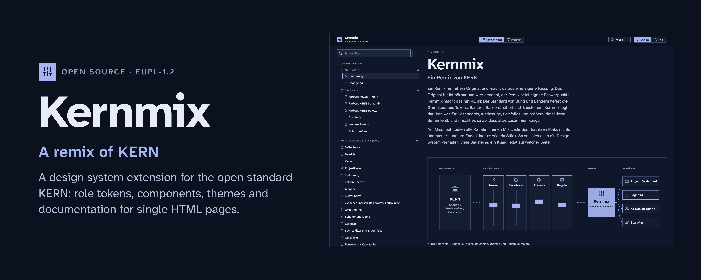
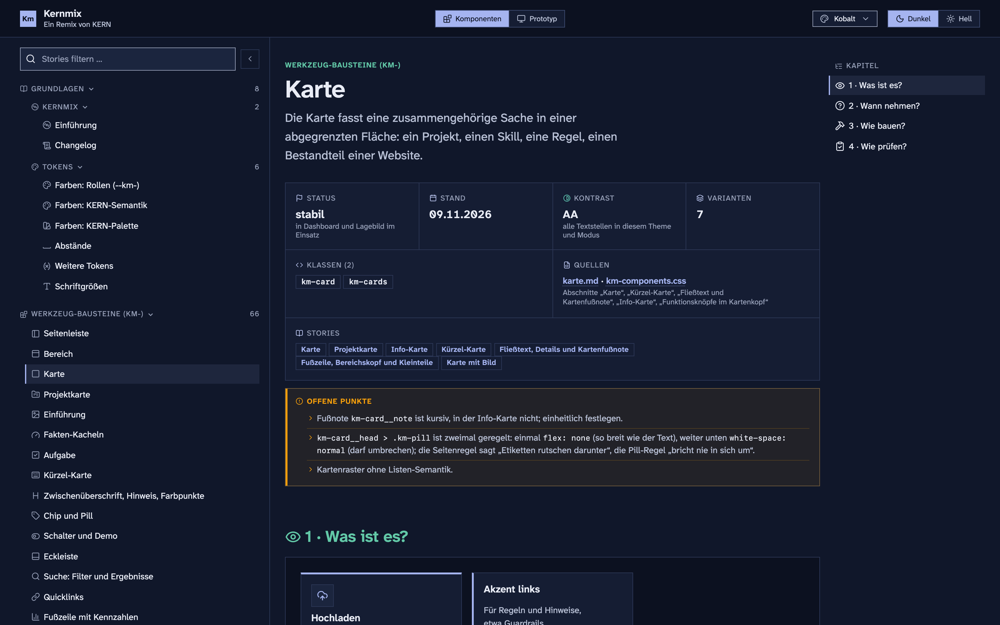
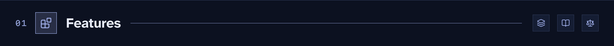
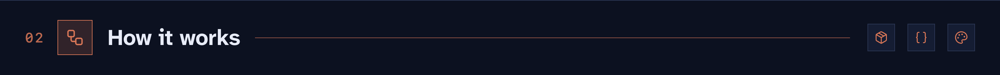
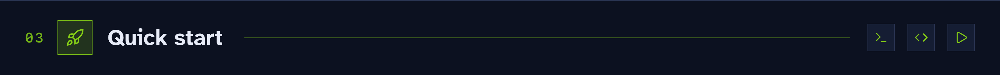
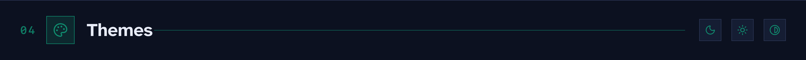
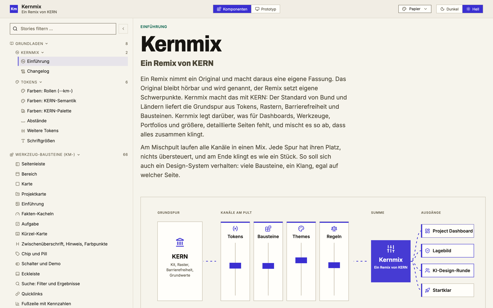
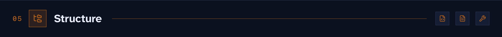
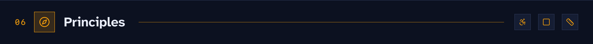
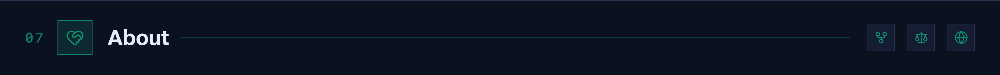

# Kernmix

**A remix of KERN.** A design system extension for the open standard [KERN](https://www.kern-ux.de/): role tokens, components, themes, and documentation for single HTML pages.

[Deutsch](README.de.md) · [Component reference online](https://kernmix.thinkrepeat.com/) · [Changelog](CHANGELOG.md)

KERN is the open UX standard of the German federal and state administrations. It brings the base track: tokens, grids, accessibility, and components. Kernmix keeps the KERN-Kit unchanged and adds what tools, dashboards, and longer documentation pages need: role tokens, more than 30 building blocks with the prefix `km-`, two themes and documentation for every component. Everything runs from `file://`, without a server, a CDN, or a package manager.

Kernmix carries the [Project Dashboard](https://github.com/donludwig/project-dashboard), which embeds it into a single HTML file.





### Tokens and themes

- 🎚️ **Role tokens** `--km-*` in `src/km-roles.css`: they point to semantic KERN tokens wherever KERN has one and extend the KERN naming scheme where it has none (colors, spacing, type).
- 🧱 **Core tokens** in `src/km-core.css`: own color ramps and five data colors `--km-color-data-*`, in OKLCH.
- 🔩 **Component tokens** `--km-component-*` for values that belong to one building block.
- 🎨 **Two themes**, light and dark each: Kobalt (`kern-nah.css`) and Papier (`startklar.css`). Without a theme the building blocks look like plain KERN.
- 🔤 **Local fonts** under SIL OFL 1.1: Atkinson Hyperlegible Next, Inter, and Archivo, loaded from files, never from a font service.
- ✏️ **Icons**: Lucide 1.49.0 in `assets/lucide.json` on a 24 px grid; stroke width, line caps, and joins come from the theme.

### Building blocks

- 🧩 **More than 30 building blocks** in `src/km-components.css`: sidebar with icon rail, section, card, table, filter bar, segmented control, chapter bar, dialog, search, column picker, tasks, and more. Building blocks read only `--km-*`.
- 📊 **Standard table** `km-table.js`: one role per column, an icon in every header cell, dates with a relative label and activity bar, sorting, row numbers, and the action column last.
- 🪟 **Panels** `km-popup.js`: every dropdown, menu, and panel closes with Esc and with a click outside, then focus returns to its button.
- 📝 **Questionnaire blocks**: answer buttons `km-answer`, check card `km-criterion`, field, score, progress, and term.
- 🧭 **Page shell** `km-shell` with a sidebar that collapses into an icon rail and a chapter bar that marks where you are.

### Documentation

- 📖 **Component reference** (`storybook/index.html`): introduction, foundations (colors, spacing, type, tokens), every building block with its documentation, proposals, and the official KERN stories. Theme, mode, and width (360, 768, 1280, full) switch in the header, and the address keeps the state.
- 🖥️ **Prototype tab**: the Project Dashboard as a demo with fictional data (`prototyp/index.html`), built on Kernmix and switched with the same theme and mode.
- 🔗 **Cross references**: each entry lists which building blocks it contains and where it is used; color contrasts are calculated live for the chosen theme and mode.
- 📚 **Component documentation** in `docs/komponenten/`: four chapters per building block (What is it? When to use it? How to build it? How to check it?) with rules for agents and people.
- 📏 **Page rules** in `docs/seitenregeln.md`: navigation, filters, tables, cards, contrast, narrow widths, and what to measure before a page is done.
- 🗳️ **Decisions** are recorded as ADRs and DDRs; they will be published later.

### Tools and checks

- 🧰 **Embedding** with `tools/einbetten.py`: kit, Kernmix, theme, and scripts go into one HTML file; `--check` reports whether the block is out of date.
- 🔍 **KERN check**: `tools/build.py` stops when a `--kern-` token used in `src/` is missing from the vendored kit.
- 🧪 **Page check**: `tools/pruefe-seiten.py` opens the built pages in headless Chrome and checks tables, panels, characters used as icons and script errors.
- ♿ **Contrast**: calculated for every text role on every surface in both themes and modes, text at least 4.5:1, controls at least 3:1.

The documentation is written in German.




Kernmix builds on the KERN-Kit as published. `vendor/kern/` holds `kern.min.css`, the Fira Sans files and a `VERSION` file of KERN-Kit 2.8.2, and Kernmix never edits them. Everything else sits on top in layers:

- The kit brings base styles and the semantic `--kern-*` tokens. Kernmix sets tokens and never overrides `kern-*` classes.
- `src/km-roles.css` maps each role to a semantic KERN token where one exists. Only where KERN has no token does Kernmix add its own, named in the KERN scheme.
- `src/km-components.css` reads only `--km-*`, never a color or size directly.
- A theme file sets token values for light and dark and adds no selectors for building blocks.
- `tools/einbetten.py` writes the kit, Kernmix, and a theme into the page, so one HTML file runs on its own.

### When KERN publishes a release

1. Replace the kit in `vendor/kern/` with the released files.
2. Run `python3 tools/build.py`. It collects every `--kern-` token that `src/` reads or that a theme sets and compares the list with the tokens defined in the new `kern.min.css`. If one is missing, the build stops and lists each file and token, so renamed or removed tokens show up at once. Known gaps stay in `KERN_AUSNAHMEN` with a reason.
3. Point the affected roles in `src/km-roles.css` to the new tokens and build again. Building blocks and themes follow, because they read roles, and Kernmix now sits on the current KERN release. The built files name the kit version in their header.

`tools/build-storybook.py` also checks every class of the official KERN stories against the vendored kit and marks missing ones at the story.



### Look around

```bash
git clone https://github.com/donludwig/kernmix.git
cd kernmix
open storybook/index.html
```

### Link it into a page

```html
<html data-kern-theme="dark">
<link rel="stylesheet" href="vendor/kern/kern.min.css">
<link rel="stylesheet" href="dist/fonts.css">
<link rel="stylesheet" href="dist/km.css">
<link rel="stylesheet" href="dist/themes/kern-nah.css">
```

Order matters: KERN-Kit, Kernmix, theme. `data-kern-theme="light"` switches to light mode.

### Embed it into a single HTML file

```bash
python3 tools/einbetten.py path/to/page.html --schriften
```

The script writes the kit, Kernmix, the theme, and both scripts between `<!-- KERN-SYSTEM:BEGIN -->` and `<!-- KERN-SYSTEM:END -->` into the `<head>`. Run it again after every change; it only replaces that block. `--zusatz-theme startklar` adds the second theme, switched off, for pages that let users choose.

### Build

```bash
python3 tools/build.py              # dist/ from src/, checks every --kern- token against the kit
python3 tools/build-storybook.py    # storybook/index.html, the component reference
python3 tools/build-doku.py         # docs/index.html
python3 tools/pruefe-seiten.py      # checks the built pages in headless Chrome
```

Python 3 standard library only. The component reference includes the official KERN stories when `KERN_STORIES` points to a folder with `*.stories.js` files from the KERN repository; without it that group is left out.



| Theme | File | Type | Character |
|---|---|---|---|
| Kobalt | `dist/themes/kern-nah.css` | Atkinson Hyperlegible Next | cool blue accent, amber signal color, square corners, and line ends |
| Papier | `dist/themes/startklar.css` | Inter, headings in Archivo Extrabold at 88 % width | warm paper surfaces, ink, indigo accent, round line ends |
| KERN | none | Fira Sans (files of the kit in `vendor/kern/fonts/`) | plain KERN |

Contrast is calculated for every text role on every surface in both modes: text at least 4.5:1, controls at least 3:1.





```
src/                    tokens, building blocks, scripts, themes, fonts.css (source)
dist/                   built CSS and JS: km.css, themes/, km-table.js, km-popup.js, fonts.css
vendor/kern/            KERN-Kit 2.8.2 (EUPL-1.2), Fira Sans files of the kit
storybook/index.html    component reference: building blocks, foundations, KERN stories, prototype tab
prototyp/               Project Dashboard demo with fictional data
docs/index.html         documentation page with every building block and the changelog
docs/komponenten/       documentation per building block (Markdown)
docs/seitenregeln.md    rules for building pages on Kernmix
proposals/              proposals for new building blocks
assets/                 Lucide icons, fonts (SIL OFL 1.1), graphics, README images
tools/                  build, embed and check scripts (Python standard library)
LICENSE, NOTICE.md      EUPL-1.2 and third-party licences
CHANGELOG.md            release notes
```



- KERN first: tokens and names follow the KERN scheme, and new parts extend KERN.
- Accessible by default: contrast measured, visible focus, keyboard operable, motion only when the system allows it.
- Square: radius 0 for everything, icons included.
- Measure, do not guess: spacing, alignment, and contrast are checked in headless Chrome before a change counts as done.
- No dependencies: no npm, no CDN, no build chain beyond Python; fonts are local files.
- Written down: every building block has documentation, and every larger choice is recorded as an ADR or DDR.



Made by Don Ludwig ([@donludwig](https://github.com/donludwig)), a freelance UX/UI designer from Berlin. I work on design systems, interface design, and accessibility for civic, cultural, and public-sector teams, close to the code and in conversation with the developers who build it. I also contribute to [KERN](https://www.kern-ux.de/), the open design system standard of the German public administration.

Kernmix is an independent project and not part of KERN.

[LinkedIn](https://www.linkedin.com/in/donludwig/) · [don@thinkrepeat.com](mailto:don@thinkrepeat.com) · [thinkrepeat.com](https://thinkrepeat.com/)

### License

[EUPL-1.2](LICENSE) (European Union Public Licence). Third-party parts (KERN-Kit, Lucide, fonts) are listed in [NOTICE.md](NOTICE.md).
